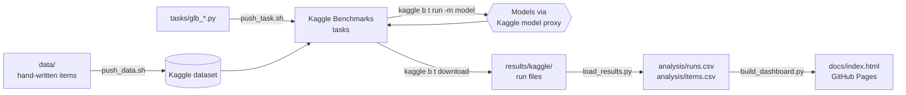

# Georgian Language Benchmark

<div align="center">
  

  <p align="center">
    <strong>Claude vs GPT, judged in Georgian. Five hand-written tasks, eight models, one fair fight.</strong>
  </p>

  <br />

  
  
  
  
  
  

  **[📊 Dashboard](https://georgekobaidze.github.io/georgian-language-benchmarks/)** · **[🏆 Benchmark on Kaggle](https://www.kaggle.com/benchmarks/georgekobaidze/georgian-language-benchmark)** · **[📖 Article](https://dev.to/georgekobaidze/georgian-language-benchmark-two-biggest-ai-labs-clash-in-a-language-that-doesnt-play-by-anyones-5b22)** · **[🐛 Report a Bug](https://github.com/georgekobaidze/georgian-language-benchmarks/issues)**

</div>

---

## Table of Contents

- [About](#about)
- [The Tasks](#the-tasks)
- [Rules of the Game](#rules-of-the-game)
- [The Dashboard](#the-dashboard)
- [Tech Stack](#tech-stack)
- [Architecture](#architecture)
- [Project Structure](#project-structure)
- [Getting Started](#getting-started)
- [Built on a Free Quota](#built-on-a-free-quota)
- [Limitations](#limitations)
- [How to Contribute](#how-to-contribute)
- [License](#license)
- [Acknowledgements](#acknowledgements)
- [Author](#author)

---

## About

**How well do AI models really know Georgian?**

Georgian is unlike any other language in the world. It belongs to the small Kartvelian family, unrelated to any of the world's major language families, and works as a whole system of its own.

- **Its own alphabet.** Georgian is written in a script used for nothing else: Mkhedruli, the youngest of three Georgian alphabets that are on UNESCO's list of intangible cultural heritage.
- **It counts in twenties.** 99 is ოთხმოცდაცხრამეტი, "four twenties and nineteen".
- **Verbs carry the whole sentence.** A single verb form can say who did what to whom, and in some tenses the roles of "who" and "whom" flip.
- **And it's a low-resource language for AI,** with only a sliver of the text that models learn the world's biggest languages from.

Models translate Georgian into English well, but can they actually *produce* correct Georgian?

The **Georgian Language Benchmark** puts that to the test. Every question was written by hand by me, a native Georgian speaker: no machine translation, no generated text. The benchmark runs on [Kaggle Benchmarks](https://www.kaggle.com/benchmarks) and pits Anthropic's and OpenAI's models against each other, level by level, under identical conditions.

Built for the [DEV × Kaggle Benchmarking Challenge](https://dev.to/challenges/kaggle-2026-09-23).

| Level | Anthropic | OpenAI |
|-------|-----------|--------|
| **Light** | Claude Haiku 4.5 | GPT-5.4 mini |
| **Decent** | Claude Sonnet 4.6 | GPT-5.4 |
| **Top** | Claude Opus 4.8 | GPT-5.5 |
| **Newest** ⚡ | Claude Opus 5 | GPT-6 Astra |

⚡ *The newest pair thinks at the lowest level ("low"); see [Rules of the Game](#rules-of-the-game).*

---

## The Tasks

| Task | What the model must do | Example | Items | Scoring |
|------|------------------------|---------|:-----:|---------|
| **Numbers** | Digits ↔ Georgian words, cardinal and ordinal, up to 10³⁹, plus fractions and decimals | 44th → ორმოცდამეოთხე | 158 | Exact match |
| **Verbs** | Read who does what to whom, build a verb form for given persons and tense, pick the right preverb | დაგიწერია → "you have written it" | 50 | Multiple choice / exact match |
| **Translation** | Translate a Georgian paragraph full of idioms and inversion verbs into English | ხელი სთხოვა → "proposed" | 12 | Judge model, 5-level meaning scale |
| **Cloze** | Fill 25 gaps in an article with the right form of words from a list with distractors | ძველ [1] … → დროში | 50 gaps | Per gap, exact match |
| **Correction** | Fix planted grammar, spelling and punctuation errors without touching correct text | ვიჯექით → ვისხედით | 17 | Partial credit, over-correction penalized |

**287 scored items per model.** The full, untrimmed sets live in [`archive/`](archive/).

---

## Rules of the Game

| Rule | Why |
|------|-----|
| **No thinking** | Every model answers directly, without hidden reasoning (`reasoning="none"`). Mixing thinking and non-thinking models would not be a fair comparison. |
| **One marked exception** | GPT-6 Astra cannot switch thinking off; its minimum is `"low"`. So the newest pair, Opus 5 and GPT-6 Astra, both think at `"low"`, and are marked ⚡ / `LOW` everywhere. |
| **Comparable pairs** | Each level pairs an Anthropic and an OpenAI model of the same class. |
| **Same prompts, same code** | English instructions, Georgian content, one task version for everyone. |
| **A fixed judge** | Translations are judged by Gemini 3 Flash (no thinking), which is not one of the tested models. |
| **Partial credit where it's fair** | Correction rewards every fixed error and penalizes every correct word the model breaks. |
| **Failures never look like scores** | If more than 5% of a task's calls fail (for example when the quota runs out), the task stops without reporting a score. |

---

## The Dashboard

The interactive results live at **[georgekobaidze.github.io/georgian-language-benchmarks](https://georgekobaidze.github.io/georgian-language-benchmarks/)**, a single static page in a dark, neon look:

- **Overview:** the level-by-level showdown, a task heatmap, costs and the key findings
- **Cost & tokens:** what each model paid per task, tokens in and out, the Georgian token gap, cost per correct answer, and what the whole project cost
- **Tasks:** numbers by question type with an automatic error taxonomy, verbs by type, correction split into fixed / missed / broken, and every cloze gap for every model
- **Examples:** real questions with every model's actual answer and an explanation of the mistake
- **Method:** where the data comes from, how each task is scored, the conditions and the limits

Every number on the page is computed from the run files by [`analysis/build_dashboard.py`](analysis/build_dashboard.py), so the dashboard and the article never disagree.

---

## Tech Stack

| Technology | Purpose |
|------------|---------|
| [Kaggle Benchmarks](https://www.kaggle.com/benchmarks) | Hosts the tasks, runs the models, keeps the leaderboard |
| [kaggle-benchmarks](https://pypi.org/project/kaggle-benchmarks/) | Python library for writing tasks, scoring and judge calls |
| [Kaggle CLI](https://github.com/Kaggle/kaggle-cli) | Uploads the dataset, pushes tasks, starts and downloads runs |
| Python 3.11+ · pandas · PyYAML | Task code and analysis |
| Vanilla HTML, CSS and JavaScript | The dashboard: no framework, no build step, no chart library |
| [GitHub Pages](https://pages.github.com) | Serves the dashboard from `docs/` |

---

## Architecture



1. **Data:** every item lives in `data/` and is uploaded as one Kaggle dataset.
2. **Tasks:** each task file reads its data file, asks the model one question per call, scores the answer and reports one score per run.
3. **Runs:** Kaggle runs a task on any model in its catalog. Every call goes through Kaggle's model proxy and is billed to the account's model quota.
4. **Results:** the downloaded run files hold every answer, score, token count and cost.
5. **Analysis:** `load_results.py` turns them into two tables; `build_dashboard.py` turns those into the dashboard.

---

## Project Structure

```
georgian-language-benchmark/
├── data/                       # The benchmark data (published as a Kaggle dataset, CC BY 4.0)
│   ├── numbers.csv             # Numbers: digits ↔ words, cardinal and ordinal
│   ├── verbs.csv               # Verbs: who to whom, verb forms, preverbs
│   ├── translation.csv         # Georgian paragraphs with English references
│   ├── cloze.yaml              # Two articles with 25 gaps each
│   ├── correction.csv          # Paragraphs with planted errors and their corrections
│   └── dataset-metadata.json   # Kaggle dataset settings
│
├── tasks/                      # One Kaggle task per file
│   ├── glb_numbers.py
│   ├── glb_verbs.py
│   ├── glb_translation.py      # Includes the fixed judge
│   ├── glb_cloze.py
│   └── glb_correction.py
│
├── scripts/
│   ├── push_data.sh            # Upload data/ as the Kaggle dataset
│   ├── push_task.sh            # Push a task with the dataset attached
│   ├── run.sh                  # Run a task on a group of models
│   └── local_run.py            # Run a task locally through the model proxy
│
├── analysis/
│   ├── load_results.py         # Run files → runs.csv + items.csv
│   ├── build_dashboard.py      # runs.csv + items.csv → docs/index.html
│   ├── dashboard_template.html # The dashboard design
│   ├── runs.csv                # One row per run: score, tokens, cost
│   └── items.csv               # One row per answer
│
├── archive/                    # Full, untrimmed data sets for testing outside Kaggle
├── docs/index.html             # The dashboard (GitHub Pages)
├── models.txt                  # Kaggle's model catalog at benchmarking time
├── LICENSE                     # MIT (code)
└── README.md                   # You are here
```

---

## Getting Started

### Prerequisites

- Python 3.11+
- A [Kaggle](https://www.kaggle.com) account

### Setup

```bash
git clone https://github.com/georgekobaidze/georgian-language-benchmarks.git
cd georgian-language-benchmarks
python3 -m venv .venv
source .venv/bin/activate
pip install -r requirements.txt
kaggle auth login       # once: connect the CLI to your Kaggle account
kaggle b auth -y        # writes short-lived model credentials to .env (never commit it)
```

### Run a task locally

Runs a sample of a task on your machine, through Kaggle's model proxy. Results go to `results/local/`.

```bash
.venv/bin/python scripts/local_run.py tasks/glb_verbs.py --limit 10
.venv/bin/python scripts/local_run.py tasks/glb_verbs.py --limit 10 --model openai/gpt-oss-120b
```

### Run on Kaggle

```bash
scripts/push_data.sh "what changed"                  # upload data/ (first run creates the dataset)
scripts/push_task.sh glb-verbs tasks/glb_verbs.py    # push a task (Kaggle test-runs it once)
kaggle b t run glb-verbs -m gpt-5.4-2026-03-05 --wait
```

### Rebuild the dashboard

```bash
cd results/kaggle && kaggle b t download glb-verbs -m gpt-5.4-2026-03-05 && cd ../..
.venv/bin/python analysis/load_results.py
.venv/bin/python analysis/build_dashboard.py
open docs/index.html
```

Run the scripts from the repository root.

---

## Built on a Free Quota

The whole benchmark was built and run on Kaggle's free model credits: **$10 per day**. That turned out to shape almost every decision.

- **Kaggle reserves the worst case.** Before each call, Kaggle reserves the model's maximum possible answer length times its price, and refuses the call if that doesn't fit, even when the real answer costs a fraction of a cent. An output limit of 32,000 tokens and two parallel calls keep that reservation affordable.
- **Thinking is where the money goes.** One test model wrote 770,000 hidden tokens for 251 one-word-to-one-paragraph answers. Without thinking, the same run is about 99% cheaper.
- **Trimmed, not shrunk.** The data sets were trimmed to the items that actually separate models; the full sets are kept in `archive/`.

The dashboard's *Cost & tokens* tab shows where every dollar went.

---

## Limitations

- **The sets are hard by design.** Numbers and verbs keep mostly items a probe model got wrong, so absolute scores are lower than they'd be on an easy set; the ranking is the meaningful part.
- **Small sets.** Some tasks have only 12 to 17 items, so differences of a few points are not significant.
- **One run per model.** Re-runs of the same model differed by about ±0.03 per task.
- **The token gap includes format overhead.** Input tokens cover the prompt plus each vendor's answer-format instructions.
- **The judge is a model.** Translation scores depend on Gemini 3 Flash's judgment of meaning.

---

## How to Contribute

Native Georgian speakers are especially welcome: new items, corrections and alternative accepted answers all make the benchmark better.

1. **Fork** the repository and create a branch:
   ```bash
   git checkout -b feature/your-feature-name
   ```
2. **Make your changes.** Data files use `|` to separate alternative correct answers.
3. **Test locally** with `scripts/local_run.py` on a small sample.
4. **Open a pull request** with a clear description of what you changed and why.

---

## License

- **Code:** [MIT License](LICENSE)
- **Data:** [CC BY 4.0](data/LICENSE)

Copyright © 2026 Giorgi Kobaidze

---

## Acknowledgements

- **[Kaggle](https://www.kaggle.com)**: for Kaggle Benchmarks and the model credits every run in this project was paid with.
- **[DEV Community](https://dev.to)**: for the [DEV × Kaggle Benchmarking Challenge](https://dev.to/challenges/kaggle-2026-09-23) that started it.
- **[Anthropic](https://www.anthropic.com)** and **[OpenAI](https://openai.com)**: for the models on the leaderboard.
- **[Google Fonts](https://fonts.google.com)**: Orbitron, JetBrains Mono, Space Grotesk and Noto Sans Georgian give the dashboard its look.
- **The Georgian language**: 33 letters, a base-20 number system and verbs that keep surprising even the best models.

---

## Author

<div align="center">

  ### Giorgi Kobaidze
  *The Builder*

  Software developer and product builder from Georgia, teaching machines his native language one ordinal at a time.

  [](https://github.com/georgekobaidze)
  [](https://www.linkedin.com/in/giorgikobaidze/)
  [](https://x.com/georgekobaidze)
  [](https://dev.to/georgekobaidze)

</div>
